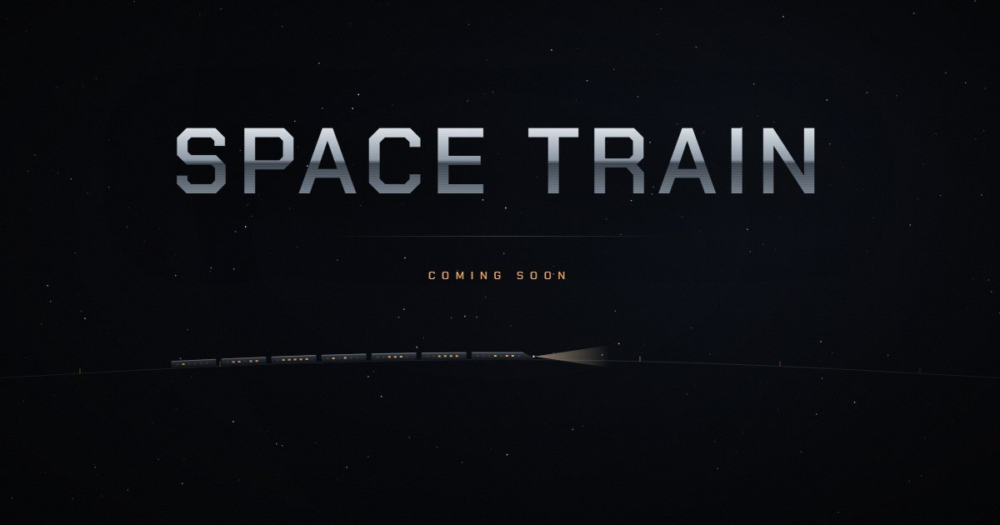
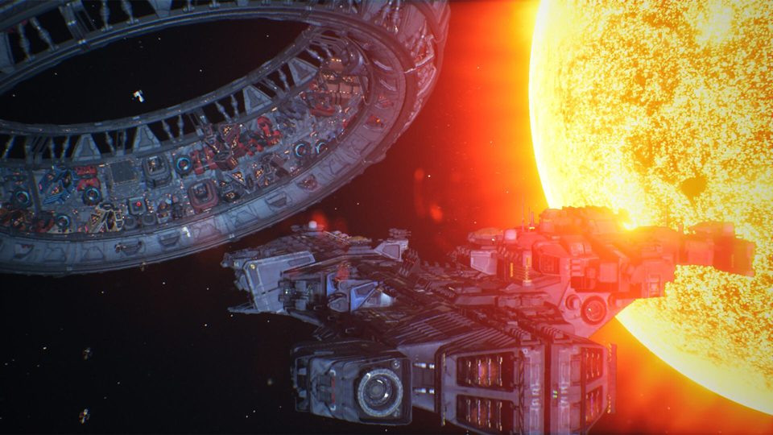

<picture>
  <source media="(prefers-color-scheme: dark)" srcset="assets/banner-dark.svg">
  <source media="(prefers-color-scheme: light)" srcset="assets/banner-light.svg">
  
</picture>

I write gameplay and systems code in Unreal Engine, mostly in C++. I work at [DBK Games](https://www.dbkgames.com/) on **SpaceBourne 2**, and on my own I'm building **Space Train**, a co-op sci-fi game.

## Space Train co-op sci-fi · PC · coming soon

**Your train. Your line. Your company.** 
Build a train wagon by wagon, haul cargo across a living galaxy and grow from hired hauler to the owner of your own line, alone or with up to three friends.

<table>
  <tr>
    <td align="center" width="25%"><h3>250</h3>sectors</td>
    <td align="center" width="25%"><h3>12</h3>station types</td>
    <td align="center" width="25%"><h3>20+</h3>wagon modules</td>
    <td align="center" width="25%"><h3>4</h3>player co-op</td>
  </tr>
</table>

- **Build it wagon by wagon.** Cargo bays, refineries, drone bays, mining lasers, crew quarters. Every wagon is an empty frame until you fit it out.
- **Bring your crew.** Everyone runs a train of their own, or climbs aboard a friend's and works the line together.
- **Crack it, refine it, sell it.** Mine asteroids with lasers and blast charges, refine the ore on board and deliver it anywhere from ice mines to trade hubs.
- **Jump the gates.** Gates and wormholes link the sectors. The long way pays better.
- **A galaxy that doesn't wait for you.** Prices move, companies post contracts and other trains share your line.
- **Hire people, build a home.** Take on crew who walk the wagons and do the work, then set up a base of your own.

[tunahansoyler.com](https://tunahansoyler.com)

## Also worked on

<table>
  <tr>
    <td width="50%"></td>
    <td width="50%">
      <b>SpaceBourne 2</b> DBK Games · 2025 
      Tens of thousands of solar systems in an open-universe space RPG and third-person shooter. Fly, fight, trade and mine, then build an empire of your own. 
      <a href="https://store.steampowered.com/app/1646850/">Steam</a>
    </td>
  </tr>
</table>

### Toolbox

`C++` `Unreal Engine 5` `Blueprints` `Python` `C# / .NET` `TypeScript`

<b>Before games</b> 2022–2023 · .NET and web

 

- [Burger-Shop](https://github.com/tunasoyler/Burger-Shop): restaurant ordering and management with a chatbot, ASP.NET Core MVC
- [StarWarsApi](https://github.com/tunasoyler/StarWarsApi): Star Wars data with generated visuals, ASP.NET
- [StockControlProject](https://github.com/tunasoyler/StockControlProject): stock that updates as orders come in, ASP.NET API
- [CalorieTracker](https://github.com/tunasoyler/CalorieTracker): daily calorie goals, C# WinForms

<a href="https://tunahansoyler.com">tunahansoyler.com</a> · <a href="https://www.linkedin.com/in/tunahan-soyler/">LinkedIn</a> · <a href="https://www.dbkgames.com/">DBK Games</a>

